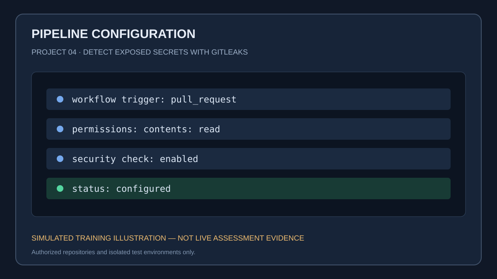
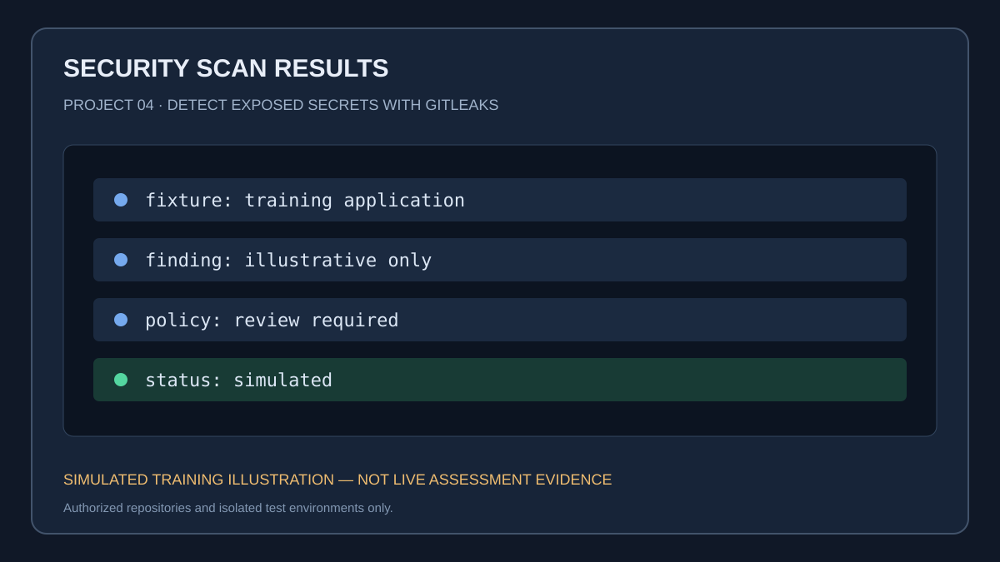
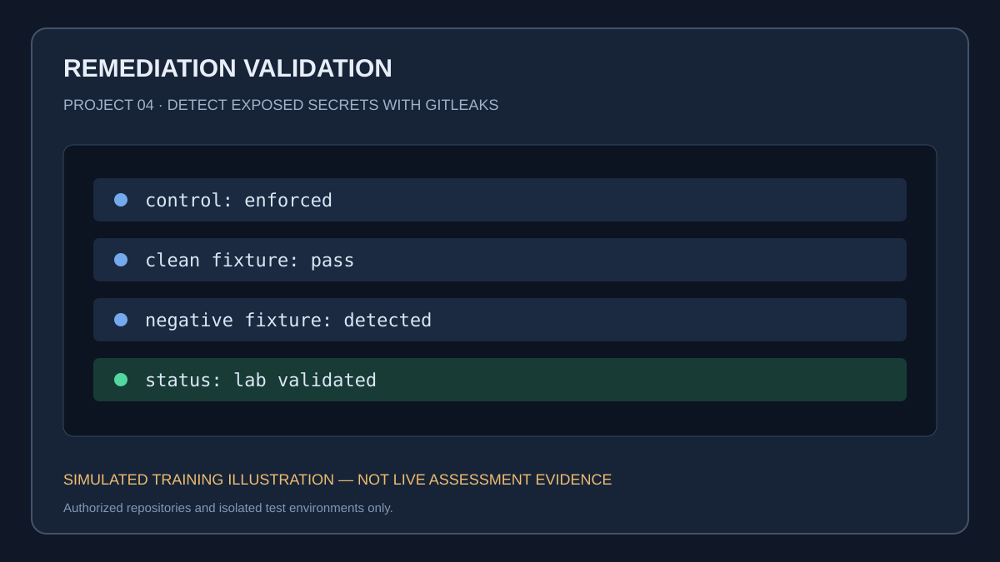

# Project 04: Detect Exposed Secrets with Gitleaks

**Level:** Beginner · **Domain:** DevSecOps / CI/CD Security

## Objectives
Implement Detect Exposed Secrets with Gitleaks as a repeatable security control; understand its value, limitations, failure modes, and operational ownership; and produce sanitized evidence suitable for a portfolio demonstration.

## Scope and authorization
Work only in a repository, application, runner, registry, cloud tenant, or cluster you own or are explicitly authorized to assess. Use disposable test fixtures and synthetic credentials. Never commit real tokens, keys, customer data, proprietary source, or production logs. Stop if testing leaves the authorized boundary.

## Prerequisites and lab
- Git, a dedicated sample repository, CI platform (GitHub Actions or GitLab CI), and a feature branch.
- Minimal sample application, test fixtures, and permission to edit workflow settings.
- The project-specific tool; verify current versions and syntax against its vendor documentation.
- Record repository, test commit, runner type, tool version, workflow triggers, and current permissions.
- Use isolated test infrastructure; do not expose privileged secrets to untrusted pull-request code.

## Implementation walkthrough
1. **Baseline:** Inspect workflow triggers, repository protections, token permissions, secret sources, dependency inputs, artifact storage, and deployment boundaries. Identify which identities can read source, publish artifacts, or deploy.
2. **Configure:** Implement **Detect Exposed Secrets with Gitleaks** with the appropriate scanner, platform setting, or policy. Begin in report-only mode when available. Review default rules, exclusions, severity thresholds, and output handling.
3. **Test:** Run a clean fixture and a controlled negative fixture intended for this lab. Confirm the control reports actionable context and does not disclose sensitive values. Never use a real credential or deploy deliberately vulnerable code.
4. **Integrate:** Run checks on the intended pull-request and default-branch events. Use minimal permissions, pin external actions/images to immutable references where possible, and separate untrusted validation from privileged release jobs.
5. **Triage:** Assess exploitability, reachability, likelihood, impact, and confidence. Assign an owner and due date. Fix root causes; exceptions must be approved, justified, and time-bounded.
6. **Retest:** Repeat both fixtures after remediation and verify that a critical failure cannot silently reach a protected release or deployment stage.

## Safe baseline commands
```bash
git status --short
git checkout -b security/04-devsecops-lab
git diff --check
```
Run the relevant tool against the local training directory and retain sanitized output. Validate workflow YAML before triggering CI. Do not pass secrets as command-line arguments or print environment variables.

## Pipeline security checklist
- Explicit least-privilege workflow permissions; no broad write token by default.
- Untrusted pull-request jobs cannot access deployment credentials.
- Third-party actions, plugins, and images are reviewed and pinned.
- Credentials are scoped, masked, short-lived, and rotated.
- Artifacts are traceable to a source commit and protected against substitution.
- Critical policy failures block protected promotion paths.
- Logs and retained artifacts are access-controlled and sanitized.

## Expected results
A successful run is reproducible; the clean fixture behaves as expected; the negative fixture is detected or blocked; findings identify the affected component and remediation; and a failed critical check cannot proceed to privileged release. Record false positives and explain exclusions.

## Findings and risk mapping
For each finding record ID, affected component, evidence location, rule/tool version, severity, likelihood, impact, confidence, owner, status, and remediation. Consider poisoned dependencies, compromised actions, cache poisoning, exposed secrets, excessive token scope, and artifact tampering. Map only relevant issues to [OWASP Top 10 CI/CD Security Risks](https://owasp.org/www-project-top-10-ci-cd-security-risks/), [NIST SSDF SP 800-218](https://csrc.nist.gov/pubs/sp/800/218/final), [SLSA](https://slsa.dev/), and [CWE](https://cwe.mitre.org/).

## Remediation and acceptance checklist
- [ ] Authorized scope, test commit, and tool versions recorded.
- [ ] Least privilege and trust boundaries reviewed.
- [ ] Clean and negative test cases executed.
- [ ] Expected detection/enforcement confirmed.
- [ ] Root cause remediated and retested.
- [ ] Exceptions approved and time-bounded.
- [ ] Evidence sanitized; no secrets or personal data included.
- [ ] Residual risk and operational owner documented.

## Portfolio deliverables
Include a short architecture/workflow description, sanitized configuration diff, CI run summary, scanner/policy output, before-and-after validation, and concise findings report. The images below are **simulated training illustrations**, not actual scan output or evidence of a live assessment.

## Further challenge
Repeat the control in a second CI provider, test an isolated bypass scenario, measure pipeline runtime impact, and document operational ownership.

## References
- [OWASP CI/CD Security Risks](https://owasp.org/www-project-top-10-ci-cd-security-risks/)
- [NIST Secure Software Development Framework](https://csrc.nist.gov/pubs/sp/800/218/final)
- [SLSA](https://slsa.dev/)
- [GitHub Actions security hardening](https://docs.github.com/en/actions/security-for-github-actions/security-guides/security-hardening-for-github-actions)

## Simulated training illustrations



