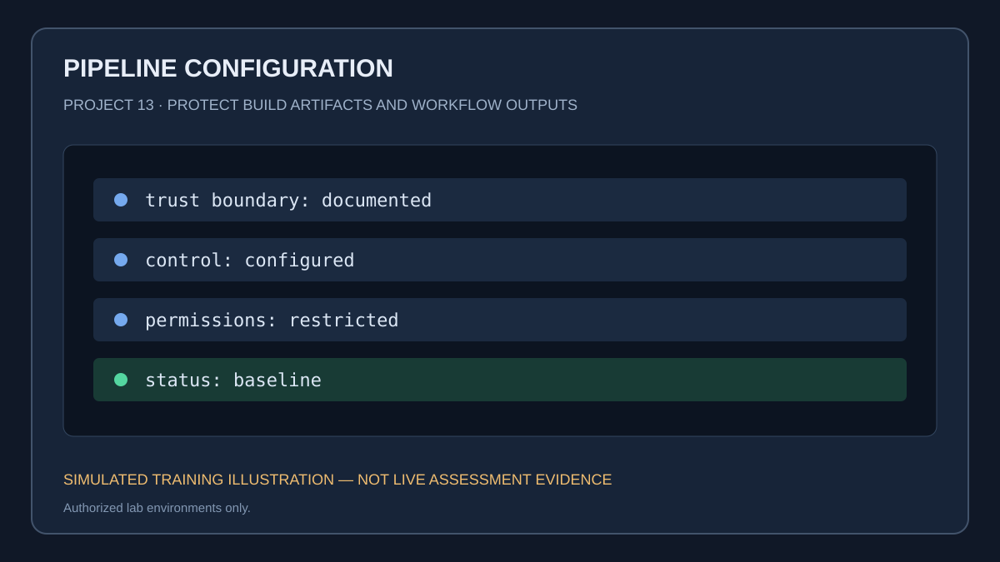
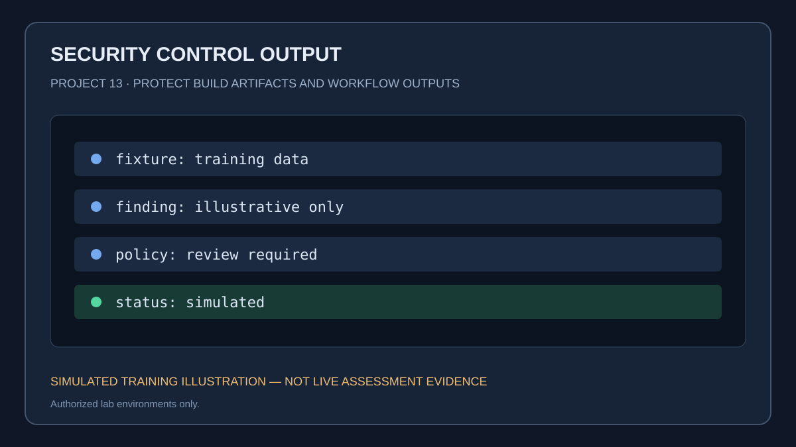
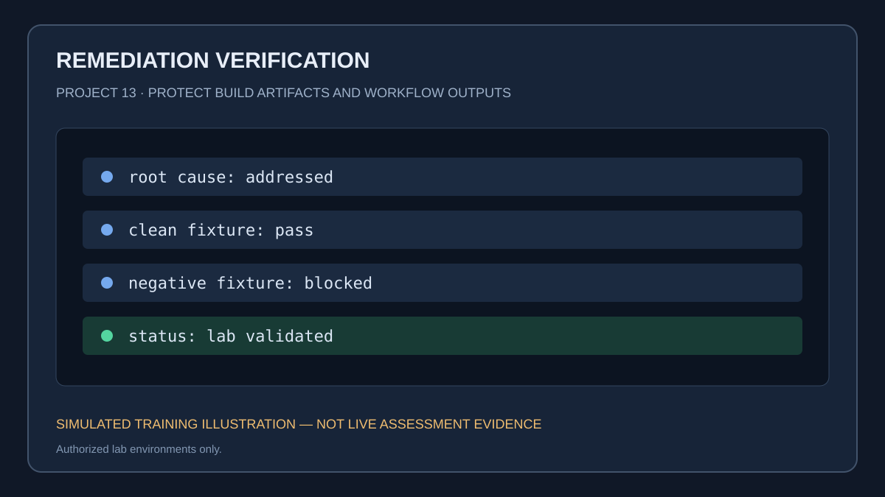

# Project 13: Protect Build Artifacts and Workflow Outputs

**Level:** Beginner · **Domain:** DevSecOps / CI/CD Security

## Objectives
Build and validate Protect Build Artifacts and Workflow Outputs in a controlled delivery lab. Demonstrate how the control reduces software-supply-chain or pipeline risk, identify bypasses and operational limitations, and document reproducible results.

## Authorization and scope
Use only your own repository, app, runner, registry, cloud account, and cluster. Obtain written authorization before testing any organization-owned system. Use disposable fixtures and synthetic credentials; never expose real secrets, customer data, or production artifacts. Keep intentionally weak examples isolated and never deploy them.

## Prerequisites and lab preparation
- Git repository with a sample application and protected feature/default branches.
- CI platform, disposable runner, and permission to configure workflows.
- Relevant tool for this project; verify version, supported formats, and vendor guidance.
- Record source commit, runner image, workflow identity/permissions, tool version, and test data.
- Separate untrusted pull-request execution from privileged release/deploy jobs.

## Implementation
### Step 1 — Map the trust boundary
Document source inputs, third-party actions/plugins, dependencies, build runner, secrets, caches, artifacts, registry, and deployment identity. Identify who can modify each stage and which transitions require review.

### Step 2 — Establish baseline
Run the existing pipeline without changing behavior. Capture duration, existing findings, permissions, output destinations, and any exclusions. Confirm no real credentials appear in logs or artifacts.

### Step 3 — Configure Protect Build Artifacts and Workflow Outputs
Implement the project-specific scanner, control, workflow, or architecture. Prefer immutable action/image references, explicit least-privilege permissions, and report-only rollout before enforcing policy. Keep configuration in version control and review it as code.

### Step 4 — Exercise controlled cases
Use a clean fixture and a deliberately misconfigured training fixture. Confirm expected detection, useful evidence, and safe failure behavior. Test boundary conditions such as missing metadata, invalid input, unavailable scanner, and unexpected exit status. Do not create a production-impacting failure.

### Step 5 — Enforce and integrate
Run checks at the correct pull-request/build/release boundary. Make critical findings block promotion. Do not allow untrusted PR content to access release credentials, mutate protected branches, or publish trusted artifacts.

### Step 6 — Remediate and retest
Fix root causes, update dependencies/configuration, and repeat the test suite. Exceptions require an owner, rationale, compensating control, expiry, and approval.

## Example safe commands
```bash
git status --short
git diff --check
git log -1 --oneline
```
Run the selected tool only against the local training workspace or authorized CI target. Validate YAML and policy syntax before enabling enforcement. Do not echo environment variables or pass secrets on command lines.

## Expected observations
A complete result includes a reproducible pipeline run, a clean fixture with expected pass behavior, a negative fixture with expected finding or rejection, useful file/resource context, and a gate that prevents unsafe promotion. Capture false-positive analysis and explain exclusions.

## Security analysis
Evaluate source integrity, dependency trust, workflow permissions, runner isolation, secrets exposure, artifact provenance, cache integrity, and deployment authorization. Record finding ID, component, evidence, tool/rule version, severity, likelihood, impact, confidence, owner, status, and due date. Map only applicable findings to [OWASP CI/CD Top 10](https://owasp.org/www-project-top-10-ci-cd-security-risks/), [NIST SSDF](https://csrc.nist.gov/pubs/sp/800/218/final), [SLSA](https://slsa.dev/), and [CWE](https://cwe.mitre.org/).

## Remediation and acceptance criteria
- [ ] Scope, authorization, and source commit documented.
- [ ] Pipeline trust boundaries and permissions reviewed.
- [ ] Tool version and baseline recorded.
- [ ] Clean and negative cases executed.
- [ ] Detection and enforcement behavior match the policy.
- [ ] Findings remediated or formally excepted.
- [ ] Retest confirms expected behavior and no sensitive leakage.
- [ ] Sanitized evidence and residual risk documented.

## Portfolio evidence
Include architecture or data-flow sketch, reviewed workflow/configuration diff, sanitized tool output, CI run summary, test fixture description, remediation notes, and before/after validation. All three images are simulated training illustrations, not actual scans, logs, or proof of a live production test.

## Extension
Add a second pipeline provider, evaluate a bypass in an isolated fork, measure operational impact, and propose an owner/SLA for ongoing maintenance.

## References
- [OWASP Top 10 CI/CD Security Risks](https://owasp.org/www-project-top-10-ci-cd-security-risks/)
- [NIST SSDF SP 800-218](https://csrc.nist.gov/pubs/sp/800/218/final)
- [SLSA framework](https://slsa.dev/)
- [GitHub Actions security hardening](https://docs.github.com/en/actions/security-for-github-actions/security-guides/security-hardening-for-github-actions)

## Simulated training illustrations



