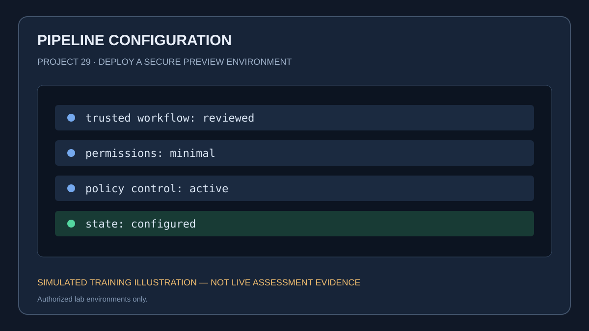
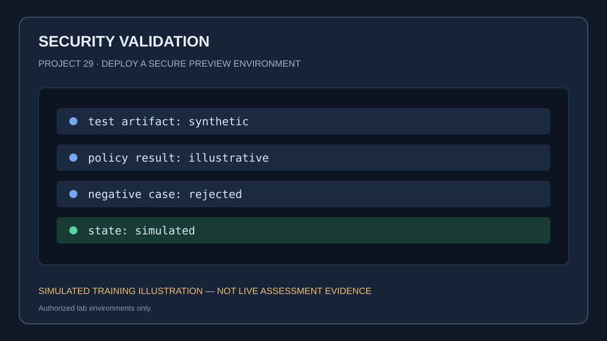
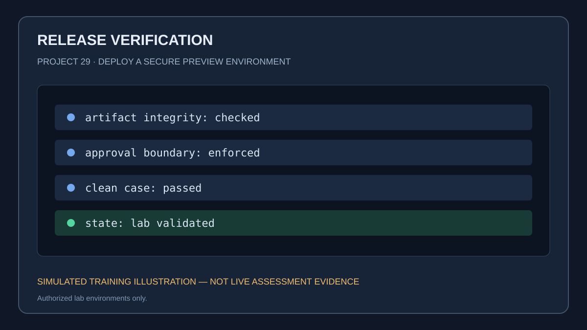

# Project 29: Deploy a Secure Preview Environment

**Level:** Intermediate · **Domain:** DevSecOps / CI/CD Security

## Objectives
Design, implement, and validate Deploy a Secure Preview Environment across a controlled software-delivery workflow. Demonstrate security impact, identify bypass conditions, and define an operational owner for the control.

## Scope and safety
Use only authorized repositories, applications, registries, runners, cloud tenants, and clusters. Keep experiments isolated from production. Use synthetic credentials and non-sensitive test fixtures. Never publish real keys, tokens, customer information, or private build artifacts. A negative fixture must never be deployed.

## Prerequisites
- Working CI pipeline and a dedicated training repository.
- Test app or infrastructure fixture and feature branch.
- Required scanner, signing tool, policy engine, or deployment test environment.
- Permission to configure repository rules and CI workflows.
- Familiarity with YAML, artifact handling, and pull-request reviews.

## Lab architecture
Map source control → CI trigger → runner → dependencies/actions → build/test → security checks → artifact store/registry → approval → deployment. Identify trust boundaries, identities, secret scopes, and artifact integrity checks. Record commit ID, tool versions, runner image, and workflow permissions.

## Implementation walkthrough
1. **Threat model:** Identify assets, entry points, trust assumptions, abuse cases, and likely failure paths for this control.
2. **Baseline:** Capture current workflow behavior, policy state, tool output, and permissions before changing configuration.
3. **Implement Deploy a Secure Preview Environment:** Configure the project-specific mechanism using version-controlled files and vendor-supported settings. Prefer immutable references, explicit policy, least privilege, and short-lived identities.
4. **Test:** Use a known-good sample plus controlled negative fixtures. Test missing/invalid metadata, tampered input, unavailable dependencies, and rejected policy cases where relevant. Keep all test data synthetic.
5. **Integrate:** Enforce the control at the correct build, pull-request, artifact, or deployment boundary. Separate untrusted validation from privileged release actions.
6. **Triage:** Review false positives, severity, exploitability, reachability, business impact, and confidence. Assign an owner and SLA; document approved exceptions with expiry.
7. **Retest:** Verify the clean path passes and unsafe path fails closed. Confirm that logs, caches, artifacts, and reports do not leak secrets.

## Safe validation commands
```bash
git status --short
git diff --check
git log -1 --oneline
```
Run project-specific validation against the local lab or authorized CI environment. Pin tool versions, validate configuration syntax, and avoid printing environment variables or embedding credentials in command arguments.

## Security controls to verify
- Minimal job and repository permissions.
- Isolation of untrusted pull-request jobs and privileged release jobs.
- Immutable action, plugin, image, and dependency references where feasible.
- Artifact identity, integrity, provenance, and access controls.
- Secret masking, short-lived credentials, rotation, and least-privilege scopes.
- Fail-closed behavior for critical policy violations.
- Controlled exception, audit, and rollback processes.

## Expected observations
A reproducible CI run should show a successful trusted path and rejection or alerting for the negative fixture. Evidence should identify the relevant component and policy decision without disclosing sensitive data. Record timing, false positives, coverage gaps, and any manual approval step.

## Risk analysis and mapping
Record finding ID, component, evidence, rule/tool version, severity, likelihood, impact, confidence, owner, remediation, and residual risk. Evaluate supply-chain compromise, dependency confusion, malicious workflow changes, artifact substitution, credential exposure, and privilege escalation. Use relevant mappings only: [OWASP CI/CD Security Risks](https://owasp.org/www-project-top-10-ci-cd-security-risks/), [NIST SSDF](https://csrc.nist.gov/pubs/sp/800/218/final), [SLSA](https://slsa.dev/), [CWE](https://cwe.mitre.org/).

## Remediation and acceptance
- [ ] Threat model and authorized scope documented.
- [ ] Baseline and configuration change recorded.
- [ ] Positive and negative fixtures executed.
- [ ] Unsafe promotion path is blocked.
- [ ] Findings remediated or formally excepted.
- [ ] Retest confirms control behavior.
- [ ] No secrets or sensitive data appear in output.
- [ ] Owner, monitoring, SLA, and residual risk documented.

## Portfolio deliverables
Include a trust-boundary diagram, sanitized workflow/policy diff, CI run summary, tool output, negative-test result, and remediation report. The images are simulated training illustrations only; they are not screenshots from a live environment.

## Advanced extension
Evaluate a second CI platform, add an adversarial test in a disposable fork, measure build-time and developer-experience impact, and propose a sustainable control owner.

## References
- [OWASP Top 10 CI/CD Security Risks](https://owasp.org/www-project-top-10-ci-cd-security-risks/)
- [NIST SSDF SP 800-218](https://csrc.nist.gov/pubs/sp/800/218/final)
- [SLSA](https://slsa.dev/)
- [GitHub Actions security hardening](https://docs.github.com/en/actions/security-for-github-actions/security-guides/security-hardening-for-github-actions)

## Simulated training illustrations



