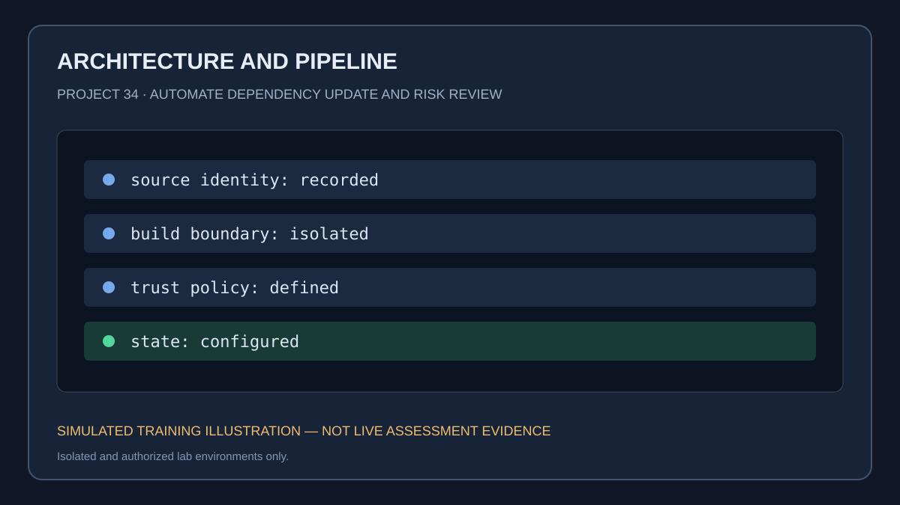
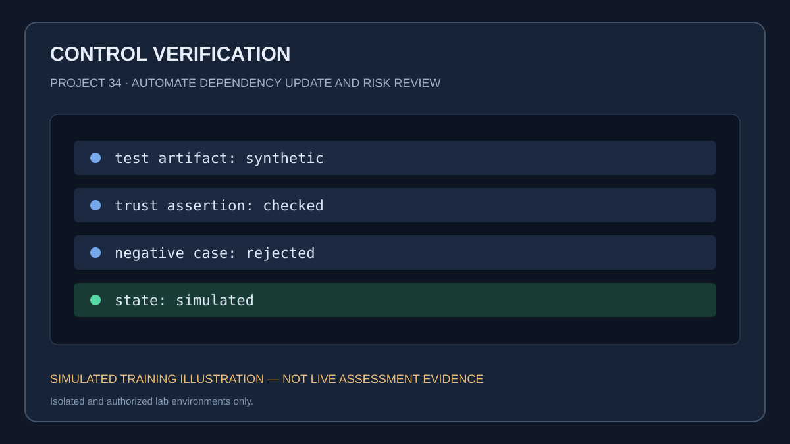
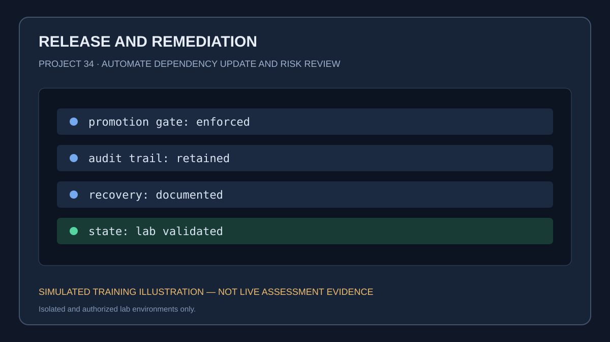

# Project 34: Automate Dependency Update and Risk Review

**Level:** Intermediate · **Domain:** DevSecOps / Software Supply-Chain Security

## Mission and objectives
Deliver a defensible implementation of Automate Dependency Update and Risk Review. Establish the trust model, implement the control, test normal and adversarial conditions in a lab, and document the evidence and residual risk.

## Authorized scope and safety
Use a disposable training repository, isolated runner, test registry, and non-production cluster/account. Test only assets you own or are explicitly authorized to assess. Use synthetic identities and data. Never deploy intentionally vulnerable artifacts, expose production credentials, or alter production admission/release policy during the exercise.

## Prerequisites
- Git, CI/CD pipeline, and a test application or infrastructure repository.
- Isolated execution environment and appropriate platform/tool permissions.
- Relevant scanner, policy engine, signing/provenance tool, registry, or Kubernetes lab.
- Record runner image, tool versions, commit ID, workflow identity, and policy configuration.

## Architecture and threat model
Trace source and review → workflow definition → runner identity → dependencies/actions → build output → artifact repository → verification/approval → deployment/runtime. Identify threats including compromised dependencies, malicious workflow edits, runner persistence, secret theft, cache poisoning, artifact substitution, provenance forgery, and policy bypass. Define trust boundaries and required controls at each transition.

## Implementation plan
1. **Baseline and inventory:** Record current build/deploy flow, identities, permissions, artifacts, caches, policies, and security findings.
2. **Design control:** Define required inputs, trust anchors, expected claims, fail-open/fail-closed behavior, exception handling, and audit trail.
3. **Implement Automate Dependency Update and Risk Review:** Use version-controlled configuration, explicit identities, immutable references, least privilege, and vendor-supported verification. Prefer ephemeral execution and short-lived workload identity.
4. **Test trust assertions:** Verify valid artifacts/configuration pass; altered, unsigned, stale, untrusted, or policy-violating fixtures are rejected as appropriate. Keep all tests in isolated environments.
5. **Integrate release path:** Place verification before artifact promotion or deployment. Ensure untrusted PRs cannot write trusted artifacts, access release credentials, or approve their own promotion.
6. **Observe and operate:** Add audit logs, alerting, ownership, service-level targets, recovery steps, and periodic review.
7. **Remediate and retest:** Address root causes and repeat the complete test matrix, including failure and recovery cases.

## Safe validation
```bash
git status --short
git diff --check
git log -1 --oneline
```
Validate manifests and policy syntax locally before connecting the lab to CI. Use dedicated test identities and never echo environment variables, tokens, or signing material. Keep private keys in a managed secret store; do not place them in repository files.

## Expected results
The implementation produces traceable decisions, identifies the source commit and artifact identity, rejects the selected negative fixtures, and preserves a recoverable audit trail. Document latency, false positives, failure modes, operational dependencies, and any residual manual approval.

## Security evaluation
Assess identity assurance, source integrity, reproducibility, artifact immutability, provenance completeness, admission/deployment enforcement, rollback safety, and auditability. Record each finding with evidence, severity, likelihood, impact, confidence, owner, remediation, and due date. Use relevant mappings to [SLSA](https://slsa.dev/), [NIST SSDF](https://csrc.nist.gov/pubs/sp/800/218/final), [OWASP CI/CD Risks](https://owasp.org/www-project-top-10-ci-cd-security-risks/), and [CWE](https://cwe.mitre.org/).

## Acceptance criteria
- [ ] Scope and trust boundaries are documented.
- [ ] Baseline architecture and identities inventoried.
- [ ] Control design and failure behavior recorded.
- [ ] Valid and invalid fixtures tested.
- [ ] Privileged promotion requires verified trust assertions.
- [ ] Audit trail is attributable and sanitized.
- [ ] Remediation and recovery procedures validated.
- [ ] Residual risks and operational owners identified.

## Portfolio deliverables
Provide architecture/data-flow diagram, threat model, policy/workflow diff, sanitized run output, test matrix, findings register, and recovery/operations notes. The visuals are simulated training illustrations only—not live infrastructure screenshots or proof of production deployment.

## Further challenge
Extend the lab across a second CI provider or cluster, model a compromised build identity, and test the recovery path without using real secrets or production resources.

## References
- [SLSA framework](https://slsa.dev/)
- [NIST Secure Software Development Framework](https://csrc.nist.gov/pubs/sp/800/218/final)
- [OWASP CI/CD Security Risks](https://owasp.org/www-project-top-10-ci-cd-security-risks/)
- [Kubernetes security documentation](https://kubernetes.io/docs/concepts/security/)

## Simulated training illustrations



