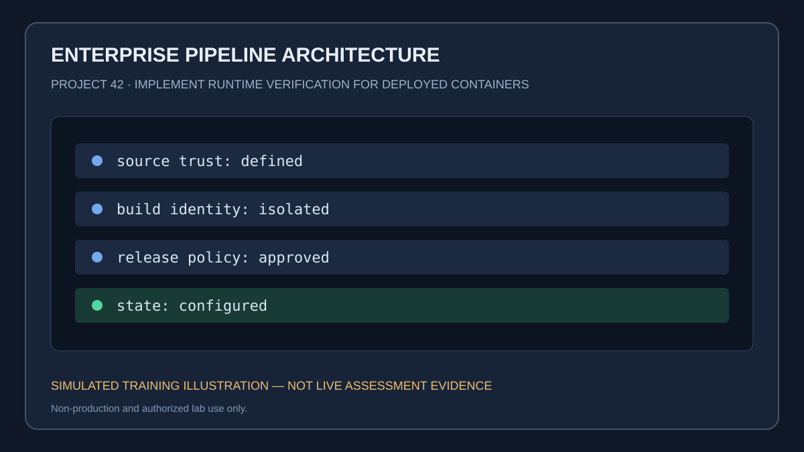
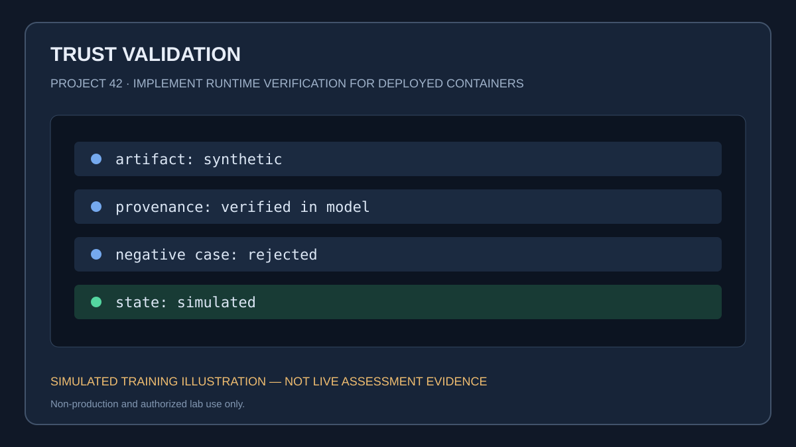
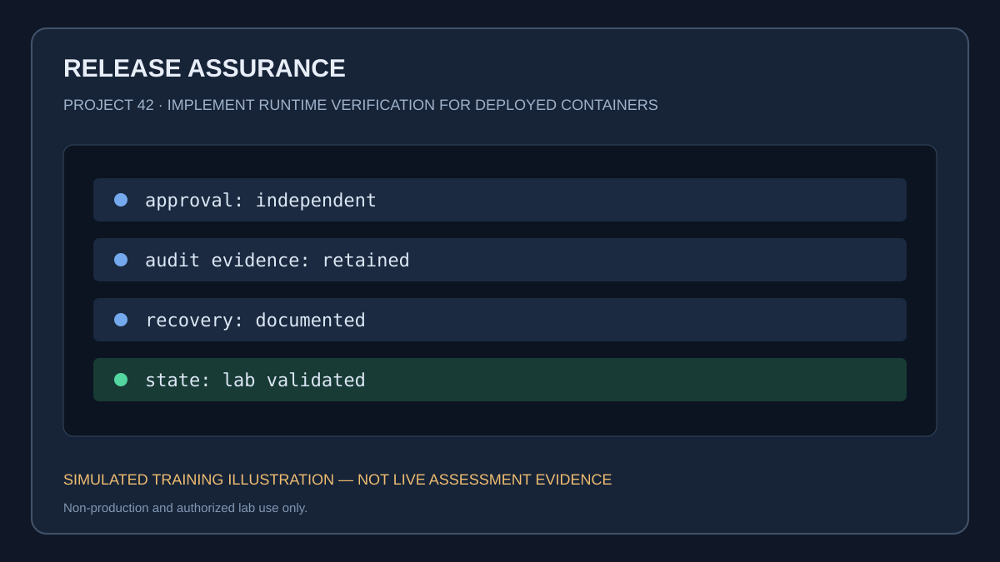

# Project 42: Implement Runtime Verification for Deployed Containers

**Level:** Advanced · **Domain:** Enterprise DevSecOps / Supply-Chain Assurance

## Mission
Design and demonstrate Implement Runtime Verification for Deployed Containers as an enterprise-grade security capability. This lab emphasizes explicit trust, identity, provenance, policy enforcement, resilience, governance, and measurable operational outcomes.

## Scope, authorization, and safety
Use isolated training repositories, test identities, disposable infrastructure, and non-production clusters/accounts. Written authorization is mandatory for organizational systems. Do not connect experiments to production deployment paths, use real credentials, expose private data, or execute destructive recovery actions against live services.

## Prerequisites
- CI/CD platform and source repository with protected branches.
- Isolated runner/cluster/cloud test account as relevant.
- Test registry/artifact store, synthetic application, and policy fixtures.
- Relevant signing, identity, policy, monitoring, or security tools.
- Documented permission to configure the test workflow and service identities.

## Enterprise design and threat model
Define assets, trust anchors, principals, data flows, security boundaries, and abuse cases. Model compromised source contributors, malicious dependencies, compromised workflow actions, runner persistence, stolen credentials, cache poisoning, artifact substitution, forged provenance, deployment policy bypass, and insider misuse. Identify preventive, detective, and recovery controls.

## Implementation work plan
1. **Baseline:** Inventory repositories, workflow templates, identities, runners, dependency sources, secrets, artifact stores, approvals, deployment targets, and audit records.
2. **Requirements:** Define security invariants, policy owners, service objectives, exception authority, retention, rollback, and recovery requirements.
3. **Build Implement Runtime Verification for Deployed Containers:** Implement a version-controlled reference configuration using least privilege, immutable references, short-lived identities, and independently verifiable evidence.
4. **Validate trust:** Create a test matrix for valid, invalid, expired, untrusted, tampered, and unavailable conditions. Verify both positive and negative paths in isolated environments.
5. **Integrate controls:** Ensure untrusted changes cannot access privileged credentials or publish trusted artifacts. Require independent approval and verification before promotion/deployment.
6. **Operationalize:** Add monitoring, alerting, audit logging, ownership, incident playbooks, key/identity rotation, recovery testing, and periodic review.
7. **Assess and improve:** Measure control coverage, failure behavior, developer friction, latency, residual risk, and governance effectiveness.

## Validation commands
```bash
git status --short
git diff --check
git log -1 --oneline
```
Use vendor-supported validation for the selected platform and tools. Test only synthetic artifacts and identities. Keep private signing keys in an approved secret manager or hardware-backed service; never commit keys or print tokens.

## Expected outcomes
The lab should show attributable source-to-artifact relationships, explicit trust decisions, enforcement at the release boundary, rejection of negative fixtures, and a recoverable audit trail. Record assumptions, limitations, availability dependencies, false positives, and residual manual steps.

## Assurance and risk register
Track control ID, threat scenario, affected assets, evidence, likelihood, impact, severity, confidence, owner, due date, status, and residual risk. Assess against [SLSA](https://slsa.dev/), [NIST SSDF SP 800-218](https://csrc.nist.gov/pubs/sp/800/218/final), [OWASP CI/CD Security Risks](https://owasp.org/www-project-top-10-ci-cd-security-risks/), and applicable [CWE](https://cwe.mitre.org/) entries. Use only defensible mappings.

## Acceptance criteria
- [ ] Enterprise scope, trust boundaries, and assumptions documented.
- [ ] Source, workflow, runner, artifact, and deployment identities inventoried.
- [ ] Threat model and security invariants reviewed.
- [ ] Valid/invalid/tampered/untrusted test matrix executed.
- [ ] Privileged release requires independent verification and approval.
- [ ] Monitoring, audit, recovery, and ownership defined.
- [ ] Remediation and retest completed.
- [ ] Residual risks and exceptions formally recorded.

## Portfolio deliverables
Publish a sanitized architecture diagram, threat model, policy/workflow implementation, test matrix, CI run summary, evidence register, recovery plan, and executive summary. Images are simulated training illustrations—not live screenshots, real signatures, or proof of production deployment.

## Further challenge
Run a purple-team exercise against the isolated pipeline, simulate a compromised build identity, validate artifact quarantine and recovery, and present a prioritized enterprise improvement roadmap.

## References
- [SLSA framework](https://slsa.dev/)
- [NIST Secure Software Development Framework](https://csrc.nist.gov/pubs/sp/800/218/final)
- [OWASP Top 10 CI/CD Security Risks](https://owasp.org/www-project-top-10-ci-cd-security-risks/)
- [Kubernetes security documentation](https://kubernetes.io/docs/concepts/security/)

## Simulated training illustrations



